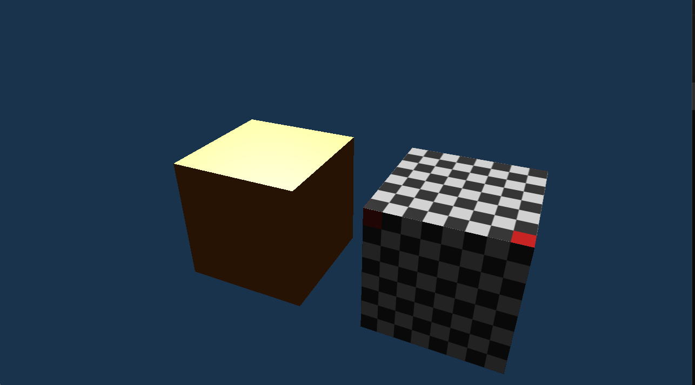

# EZSE

A small game and rendering engine in C++20 and OpenGL 4.6, built from scratch as a learning
project. The goal is to understand how an engine fits together, and to keep its parts reusable on
their own: the renderer, for example, does not know about the ECS, files or windows.



## Features

- **Renderer**: OpenGL 4.6 in Direct State Access style; meshes, shaders and textures behind
  handles; camera and light in uniform buffers; depth test and back-face culling.
- **Lighting**: one directional light with ambient, diffuse (Lambert) and specular (Blinn-Phong).
- **Textures and materials**: PNG loading with stb_image, mipmaps and trilinear filtering; a
  material per object with a shader, a texture, a tint and its own shininess.
- **ECS**: entities, components stored in sparse sets, signatures as bitsets, and systems that
  run in a fixed order.
- **Engine**: owns the window, the renderer and the world, and runs the game loop.
- **Math**: hand-written `Vec3`, `Vec4` and `Mat4` with transforms and a perspective projection,
  checked by its own test program.
- **Platform**: a GLFW window behind its own interface, with keyboard and mouse input.

The Sandbox shows two lit cubes that share one mesh but have different materials, and you can
walk around them.

## Structure

Each module is a separate static library, with dependencies in one direction:

| Module | Contents |
|---|---|
| `Core` | logging, asserts, reading files |
| `Math` | vectors, matrices and transforms |
| `Platform` | window and input (GLFW) |
| `Renderer` | everything that talks to OpenGL |
| `ECS` | entities, components and systems |
| `Engine` | game loop, built-in components and systems |
| `Sandbox` | a small test "game" that uses the engine |

`MathTests`, `ECSTests` and `EngineTests` are small test programs without a window.

## Building

Requirements: Windows, Visual Studio 2022 with the C++ workload, CMake 3.24 or newer, and a GPU
with OpenGL 4.6 support. The first configure downloads GLFW 3.4.

```bash
cmake -S . -B build
cmake --build build
./build/Sandbox/Debug/Sandbox.exe
```

Or open `build/EZSE.sln` in Visual Studio and press F5.

## Controls

| Input | Action |
|---|---|
| W A S D | walk |
| Mouse | look around |
| Escape | quit |

## How it was made

Every design decision is recorded, with its reasoning, in [`CLAUDE.md`](CLAUDE.md) (in Dutch).
I wrote the rendering, math and ECS code myself, with Claude (an AI assistant) as a tutor and
reviewer: it explained the background, discussed the options with me and reviewed my code. Claude
wrote the infrastructure (CMake, logging, the window) and some routine parts after I approved
them; `CLAUDE.md` notes where.

## Third-party code

- [GLFW](https://www.glfw.org/) 3.4 (zlib license), fetched by CMake
- [glad](https://github.com/Dav1dde/glad) 2, generated OpenGL loader in `ThirdParty/glad/`
- [stb_image](https://github.com/nothings/stb) 2.30 (public domain or MIT) in `ThirdParty/stb/`
