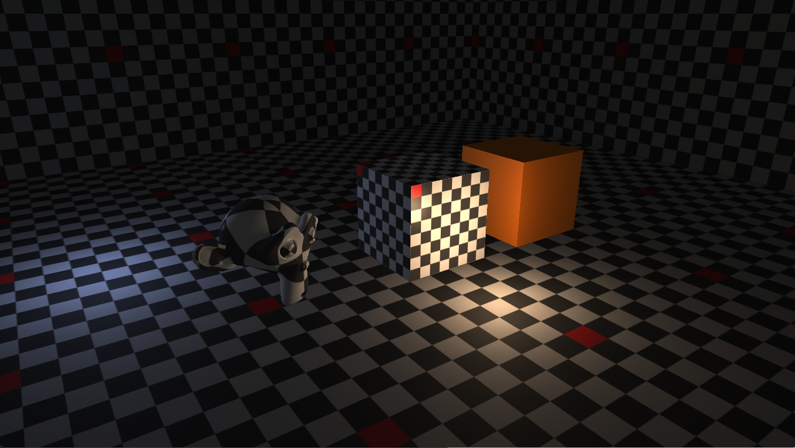

# EZSE

A small game and rendering engine in C++20 and OpenGL 4.6, built from scratch as a learning
project. The goal is to understand how an engine fits together, and to keep its parts reusable on
their own: the renderer, for example, does not know about the ECS, files or windows.



## Features

- **Renderer**: OpenGL 4.6 in Direct State Access style; meshes, shaders and textures behind
  handles; camera and lights in uniform buffers; depth test and back-face culling; linear colors
  with an sRGB framebuffer.
- **Lighting**: a directional light with a shadow map, ambient light, and up to 16 point lights
  and 16 spot lights, with diffuse (Lambert) and specular (Blinn-Phong) shading.
- **Textures and materials**: PNG and JPG loading with stb_image, mipmaps and trilinear
  filtering; a material per object with a shader, a texture, a tint and its own shininess.
- **ECS**: entities, components stored in sparse sets, signatures as bitsets, and systems in
  phases (simulation per tick, presentation per frame) and groups that set their order.
- **Engine**: owns the window, the renderer and the world, and runs the game loop: a fixed tick
  with an accumulator and interpolation between ticks for smooth movement. It also runs
  headless, without a window or GPU, as a game server will.
- **Assets**: a virtual file system with mount points and namespaces (`engine/...`,
  `sandbox/...`), strict path rules so a path works the same on every OS, engine assets copied
  next to every executable, and a magenta fallback for anything that fails to load.
- **Debug UI**: Dear ImGui panels for stats, the shadow map, lights and the camera (F1).
- **Math**: hand-written `Vec3`, `Vec4`, `Mat4` and `Quat` with transforms, projections, slerp
  and Euler angles.
- **Platform**: a GLFW window behind its own interface, with keyboard and mouse input, and a
  precise sleep for the headless loop.

The Sandbox shows two cubes and Suzanne from Blender in a room, lit by the sun, a warm and a blue
point light and a spot light, and you can walk around them. Suzanne turns at 5 ticks per second,
smoothly drawn in between. `Sandbox --headless` runs the same simulation without a window and
logs the ticks.

## Structure

Each module is a separate static library, with dependencies in one direction:

| Module | Contents |
|---|---|
| `Core` | logging, asserts, reading files, the virtual file system |
| `Math` | vectors, matrices and transforms |
| `Platform` | window and input (GLFW), precise sleeping |
| `Renderer` | everything that talks to OpenGL |
| `ECS` | entities, components and systems |
| `Engine` | game loop, built-in components and systems, resources, debug UI |
| `Sandbox` | a small test "game" that uses the engine |

`CoreTests`, `MathTests`, `ECSTests` and `EngineTests` are small test programs without a window;
`ctest --test-dir build -C Debug` runs them all after a build.

## Building

Requirements: Windows, Visual Studio 2022 with the C++ workload, CMake 3.24 or newer, and a GPU
with OpenGL 4.6 support. The first configure downloads GLFW 3.4 and Dear ImGui.

```bash
cmake -S . -B build
cmake --build build
./build/Sandbox/Debug/Sandbox.exe
```

Or open `build/EZSE.sln` in Visual Studio and press F5.

## Controls

| Input | Action |
|---|---|
| W A S D | walk |
| Mouse | look around |
| F1 | show or hide the debug UI (frees the cursor) |
| Escape | quit |

## How it was made

Every design decision is recorded, with its reasoning, in [`CLAUDE.md`](CLAUDE.md) (in Dutch).
I wrote the rendering, math and ECS code myself, with Claude (an AI assistant) as a tutor and
reviewer: it explained the background, discussed the options with me and reviewed my code. Claude
wrote the infrastructure (CMake, logging, the window) and some routine parts after I approved
them; `CLAUDE.md` notes where.

## Third-party code

- [GLFW](https://www.glfw.org/) 3.4 (zlib license), fetched by CMake
- [glad](https://github.com/Dav1dde/glad) 2, generated OpenGL loader in `ThirdParty/glad/`
- [stb_image](https://github.com/nothings/stb) 2.30 (public domain or MIT) in `ThirdParty/stb/`
- [Dear ImGui](https://github.com/ocornut/imgui) 1.93 (MIT license), fetched by CMake
